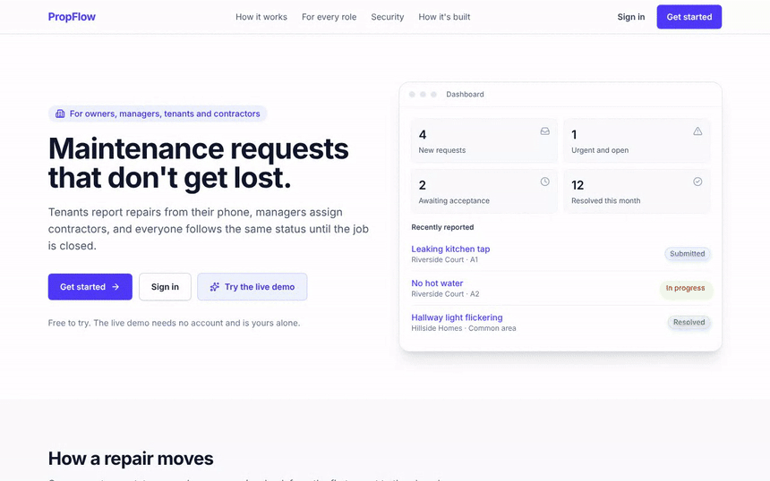
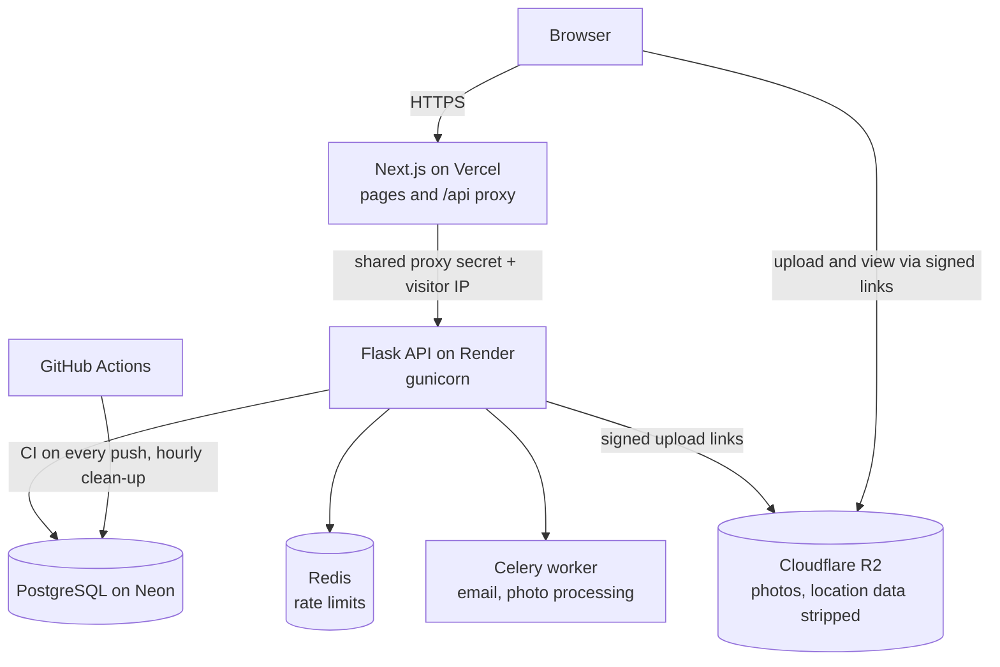
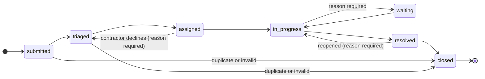
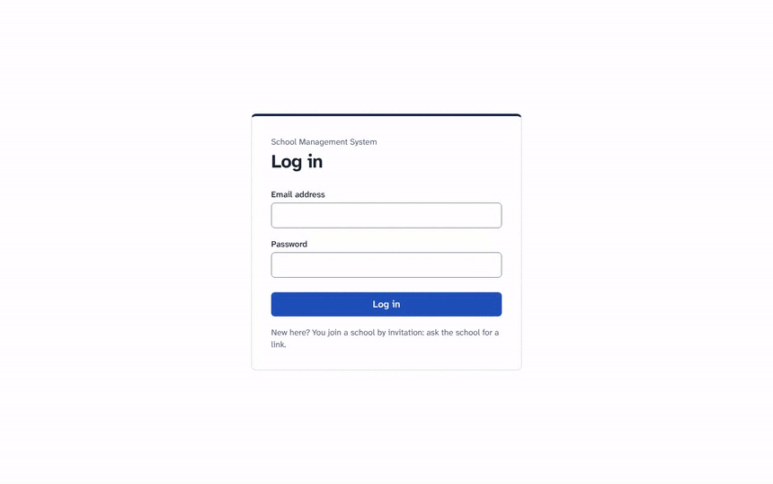
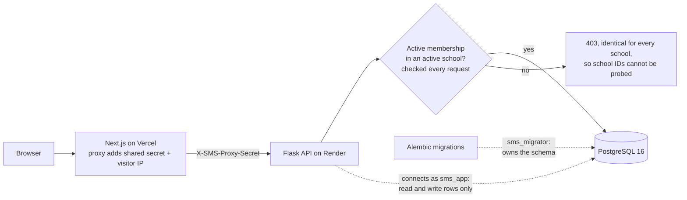
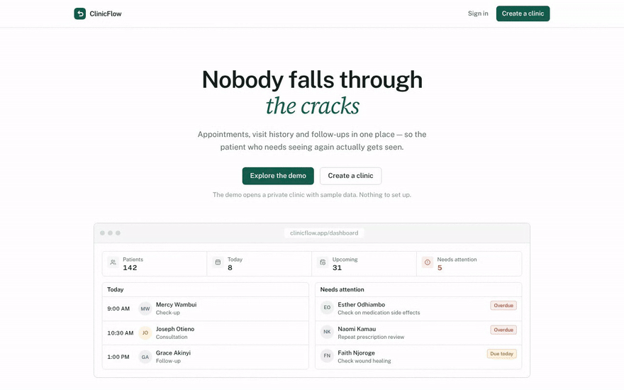
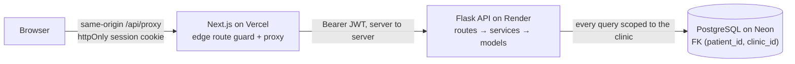
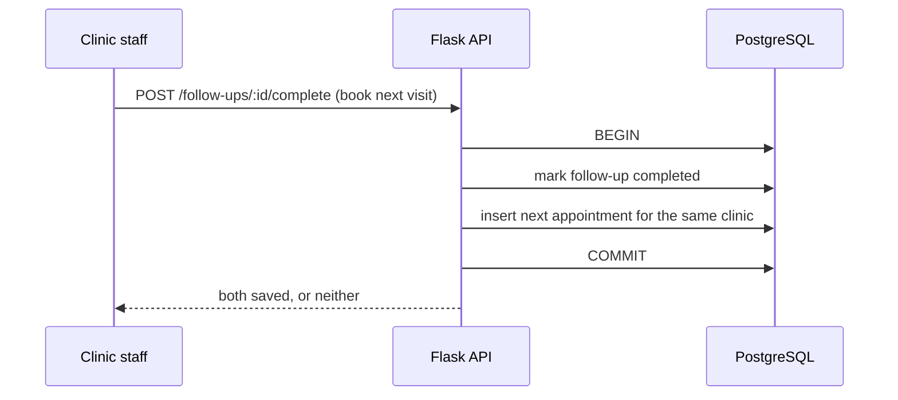
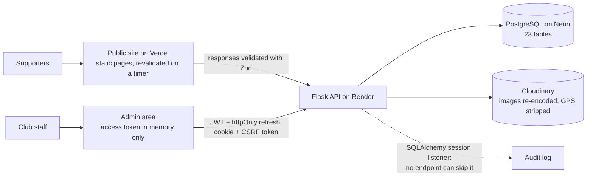

<picture>
  <source media="(prefers-color-scheme: dark)" srcset="assets/header-dark.svg" />
  <source media="(prefers-color-scheme: light)" srcset="assets/header-light.svg" />
  
</picture>

 

📍 Nairobi, Kenya &nbsp;·&nbsp; Open to **Full-Stack**, **Frontend** and **Backend** engineering roles, remote or on-site

---

## About me

I build multi-tenant web applications end to end: the database schema, the API, the security
model, the interface and the deployment. I care most about the parts users never notice until
they fail: tenant isolation, authentication, data integrity, honest error states and safe releases.

I trained in Software Engineering at **Moringa School**. Before that I worked in construction
site monitoring and network installation, which taught me to understand the real-world workflow
first, then design the system so the costly mistakes cannot happen.

**What you can expect in my repositories**

- **Production-minded architecture.** Typed Next.js frontends behind a server-side proxy, layered Flask APIs (routes → services → models), and PostgreSQL schemas that enforce rules rather than trusting application code.
- **Security by default.** httpOnly cookie sessions, Argon2id password hashing, CSRF protection, nonce-based CSP, rate limiting, timing-safe login and per-tenant data isolation.
- **Tests and CI as standard.** More than 1,600 automated tests across my featured projects (pytest, Vitest and Playwright), run by GitHub Actions with linting, type checks, dependency audits and secret scanning.
- **Written decisions.** Architecture Decision Records, documented trade-offs and an honest list of known limitations in every serious project.

---

## Featured projects

### 🏢 [PropFlow](https://github.com/Griffinsshem/propflow) · Property maintenance, from report to resolved
**[Live demo →](https://propflow-omega-tawny.vercel.app)** &nbsp;·&nbsp; a private sandbox per visitor, no signup

Tenants report repairs from their phone, managers assign contractors, and every party follows one
auditable status trail until the job is closed. Each role (owner, manager, tenant, contractor) gets its own dashboard.

- **Security:** opaque server-side sessions, Argon2id, HMAC-based CSRF, nonce CSP, one central permission matrix enforced on every request, an append-only audit log, and Redis rate limits keyed by account and IP.
- **Correctness:** optimistic concurrency so simultaneous edits are surfaced instead of overwritten; requests and work orders run on explicit state machines.
- **Performance:** load-tested with 16,000 tenants and 64,000 requests. `EXPLAIN ANALYZE` profiling cut the owner dashboard from **36.8 ms to 17.8 ms**, and a 12,434-request load test finished with **0% failures**.
- **Quality:** **368 API tests**, **76 frontend unit tests** and **46 Playwright browser journeys** in CI, plus **21 Architecture Decision Records**.

<b>How it's built: architecture and the maintenance state machine</b>

 

Every status change goes through one transition table. Anything not listed is rejected with a `409`,
and each arrow requires a named permission from the central matrix:

`Next.js 16` `TypeScript` `TanStack Query` `React Hook Form` `Zod` `Flask` `SQLAlchemy 2` `Celery` `PostgreSQL` `Redis` `Cloudflare R2` `Playwright`

---

### 🏫 [School Management System](https://github.com/Griffinsshem/school-management-system) · Multi-school SaaS for Kenyan schools
**[Staging →](https://school-management-system-one-peach.vercel.app)** &nbsp;·&nbsp; fictional data only, in active development

One platform for administrators, teachers, finance staff, parents and students, with strict school-level data isolation.

- **Academics:** class registers, marks entry, CBC and KCSE grading, term results, class teachers' comments and printable report cards.
- **Finance:** fee structures per grade and term, bills, payments, receipts, statements and arrears tracking, all print-ready.
- **Security:** revocable server-side sessions (only SHA-256 token hashes stored), Argon2id tuned to OWASP guidance, three-layer CSRF defence, and the active school taken only from the server session, re-checked on every request.
- **Quality:** **770+ backend tests** and Playwright browser tests, with CI against a throwaway PostgreSQL 16 database.

<b>How it's built: request path and least-privilege database</b>

 

The API's database user cannot create or alter tables, and a test proves it. The test harness also
refuses to run against any database whose name does not end in `_test`.

`Next.js 16` `React 19` `TypeScript` `Tailwind CSS 4` `Flask 3.1` `SQLAlchemy 2.1` `Pydantic` `PostgreSQL 16` `Alembic` `Playwright`

---

### 🩺 [ClinicFlow](https://github.com/Griffinsshem/clinicflow) · Appointments and follow-ups for small clinics
**[Live demo →](https://clinicflow-mu-nine.vercel.app)** &nbsp;·&nbsp; one click opens a private clinic with sample data

Built around one real failure in paper-based clinics: the patient told to come back in six weeks
who is never contacted again. Patients, appointments, follow-ups and a daily dashboard.

- **Isolation in the schema:** composite foreign keys on `(patient_id, clinic_id)` make cross-clinic records impossible to write; a scoping layer prevents cross-clinic reads, and foreign records return 404 so IDs cannot be probed.
- **Correct by construction:** "overdue" is computed per request in the clinic's own timezone instead of stored, so it is never stale and needs no background job.
- **Secure sessions:** the JWT lives in an httpOnly cookie behind a same-origin Next.js proxy, so an XSS bug cannot steal it. Login is timing-safe against account enumeration.
- **Quality:** **99 backend tests**, 15 of them dedicated to cross-tenant isolation. Production refuses to boot with placeholder secrets or wildcard CORS.

<b>How it's built: request path and the one-transaction follow-up</b>

 

Completing a follow-up and booking the next visit is a single transaction, so a patient can never
end up with a closed follow-up and no appointment:

`Next.js 16` `TypeScript` `Tailwind CSS v4` `Flask` `SQLAlchemy 2` `Pydantic v2` `PostgreSQL 16` `Vercel` `Render` `Neon`

---

### ⚽ [Kitengela Marines FC](https://github.com/Griffinsshem/kitengela-marines) · Club website and CMS for a real client
**[Live site →](https://kitengela-marines.vercel.app)**

The official website and content management system for a Kenyan football club with men's and
women's teams. Every fixture, result, player, article and photo is managed by club staff through
an admin area; nothing on the public site is hardcoded.

- **Domain model:** 23 PostgreSQL tables covering teams, players, staff, competitions, fixtures, results, standings, news, galleries, sponsors and an audit log.
- **Authorisation:** capability-based permissions scoped per team, so one team's coach cannot edit another's squad. Access tokens live in memory only; refresh tokens sit in httpOnly cookies with CSRF double-submit protection.
- **Craft:** View Transitions that morph a player's photo into their profile, scroll-driven CSS motion that stops under `prefers-reduced-motion`, Zod-validated API responses, and every time shown in Nairobi time.
- **Quality:** **226 API tests** and **35 frontend tests** behind one quality gate (`ruff`, `mypy`, `pytest`, `eslint`, `tsc`, `vitest`, `next build`) run by a pre-commit hook.

<b>How it's built: public site, admin area and audit trail</b>

 

Editors' HTML is sanitised against an allow-list on save and again on read, and deletes are refused
with an explanation rather than silently cascading.

`Next.js 16` `TypeScript` `Tailwind v4` `Zod` `Motion` `Flask 3` `SQLAlchemy 2` `Pydantic` `PostgreSQL` `Cloudinary` `mypy` `Vitest`

---

## Tech stack

**Languages**

**Frontend**

**Backend**

**Data and storage**

**Testing and quality**

**DevOps and hosting**

---

## Engineering practices I apply

| Area | How it shows up in my work |
|---|---|
| **Multi-tenancy** | Tenant boundaries enforced by composite foreign keys and server-side context, never by IDs sent from the client |
| **Authentication** | httpOnly, SameSite cookies; revocable server-side sessions; Argon2id; timing-safe login; per-account and per-IP rate limits |
| **API design** | Versioned REST (`/api/v1`), a consistent response envelope, strict Pydantic validation (`extra="forbid"`), and generic error messages to clients |
| **Data integrity** | Migrations tested up and down, CHECK constraints, explicit state machines, optimistic concurrency, and refused deletes instead of silent cascades |
| **Performance** | Aggregate queries instead of loading rows, `EXPLAIN ANALYZE` at realistic data volumes, and k6 load tests against latency budgets |
| **Frontend craft** | View Transitions, scroll-driven CSS motion with reduced-motion fallbacks, loading skeletons, and empty states that say why something is empty |
| **Delivery** | CI on every push, configuration validated at boot, migrations gated before traffic, and documented zero-cost deployments |

---

## More projects

| Project | Description | Stack |
|---|---|---|
| [SokoMtaani](https://github.com/Griffinsshem/Sokomtaani) | Full-stack marketplace connecting local buyers and sellers, with auth, listings, categories and favourites | Next.js · Flask · SQLite |
| [Gym Management Dashboard](https://github.com/Griffinsshem/gym-management-dashboard) | Admin dashboard for memberships, payments and attendance | Next.js · Tailwind CSS |
| [Cartify](https://github.com/Griffinsshem/Cartify) | E-commerce storefront with authentication and cart management | React · Firebase |
| [Smart Goal Planner](https://github.com/Griffinsshem/smart-goal-planner) | Savings goal tracker with milestones, deadlines and progress views | Next.js · JSON Server |

---

## Education

**Moringa School** · Software Engineering Program (2025)
Full-stack web development: JavaScript, React, Python, Flask, SQL, REST API design, testing and collaborative Git workflows.

---

**I'm looking for a team that takes engineering quality seriously.**
If that's yours, let's talk: [LinkedIn](https://www.linkedin.com/in/griffins-shem-ondeyo/) · [griffinsshem254@gmail.com](mailto:griffinsshem254@gmail.com)

Demo recordings use each project's built-in demo or fictional test data. No real patient, tenant or student records appear.

